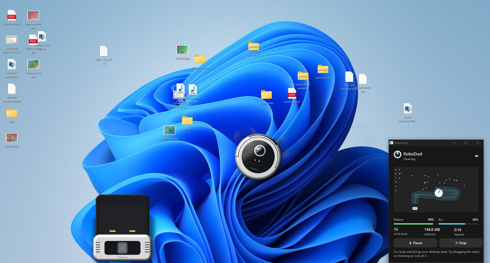

# RoboDust for Windows

The same robot vacuum, ported to Windows 10 and 11. It reads your real desktop icons from Explorer, cleans them up, and at the end sorts them into columns, moves them to the Recycle Bin, or deletes them.



It's a separate program from the Mac app, written in Rust: [wgpu](https://wgpu.rs) for the drawing (the Metal shaders are ported to WGSL in [`src/shaders.wgsl`](src/shaders.wgsl)), [egui](https://github.com/emilk/egui) for the panel, and cpal for the synthesised sounds. The simulation in [`src/sim.rs`](src/sim.rs) is a straight port of `Sim.swift`, so the robot behaves the same.

## What's different from the Mac

- The panel is a small window in the bottom-right corner instead of a menu bar popover.
- "Trash" is the Recycle Bin. Undo puts the files back from the Recycle Bin where they came from.
- Tidy up uses Explorer's own icon grid. It needs "Auto arrange icons" switched off (right-click the desktop, View).
- Besides the Mac's rules, Trash and Delete also leave shortcuts (`.lnk`, `.url`), programs, items on the Public desktop, and This PC or the Recycle Bin alone. A OneDrive desktop gets the same warning as iCloud does on the Mac.
- No auto-updates yet.

The one file that changes anything on disk is the `fileops` module in [`src/platform/windows.rs`](src/platform/windows.rs). Every file it touches is logged to `%LOCALAPPDATA%\RoboDust\history.log`.

## Build it

You need [Rust](https://rustup.rs). On Windows:

```
cd windows
cargo build --release
target\release\robodust.exe
```

To build on Linux for Windows, install the MinGW toolchain (`mingw-w64-gcc` on Arch) and the Rust target:

```
rustup target add x86_64-pc-windows-gnu
cargo build --release --target x86_64-pc-windows-gnu
```

The result is a single `robodust.exe` with no installer and nothing else to ship.

On Linux and macOS it builds too, but only runs the sample mess. That's handy for working on the robot without a Windows machine: `--dump 5,12,30 --out frames` renders those moments of a run to PNG files without opening a window.

## Testing on a real desktop

Please don't. Use a virtual machine with a throwaway desktop, or `--test-root <folder>`, which makes a folder of junk stand in for the desktop. Other flags for development:

- `--auto` starts a run right away.
- `--test-mode 0|1|2` picks Tidy up, Recycle Bin or Delete with `--test-root`.
- `--debug` writes the graphics adapter, the frame times and what Explorer reports to `%LOCALAPPDATA%\RoboDust\debug.log`.

Without a graphics card (a VM, Remote Desktop) Windows draws with its software renderer. It works, but only at a few frames per second.
